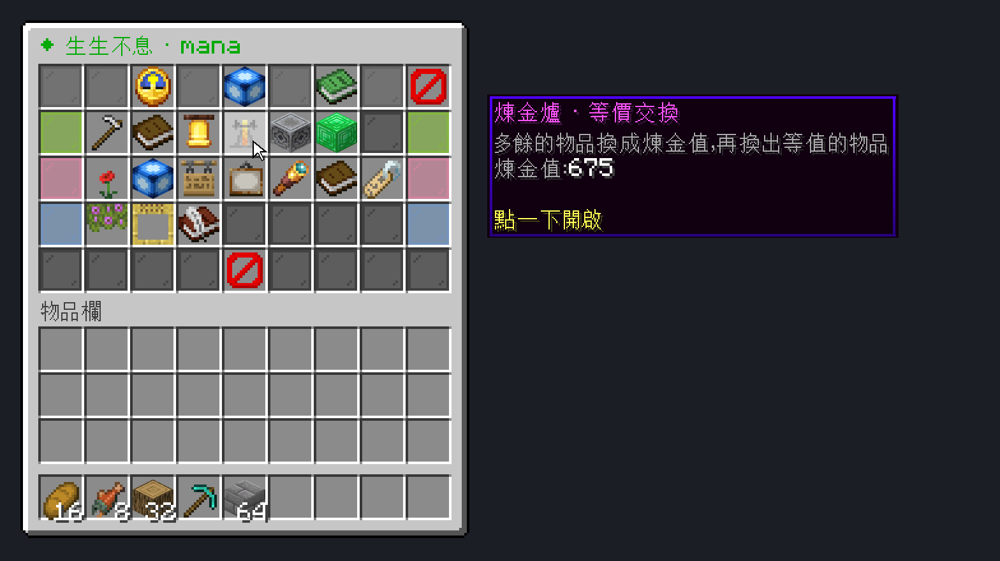
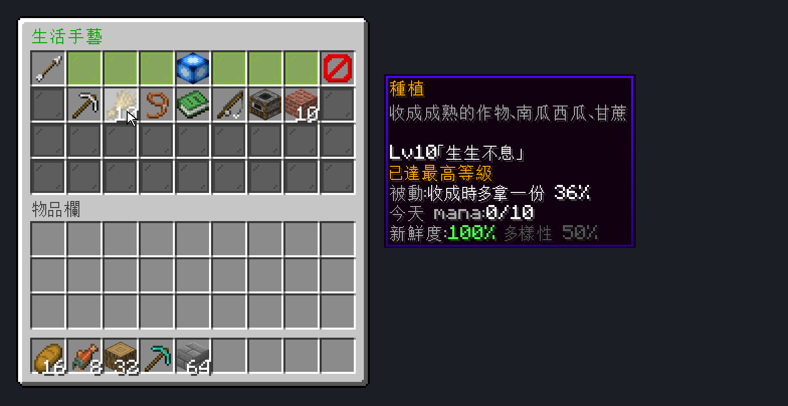
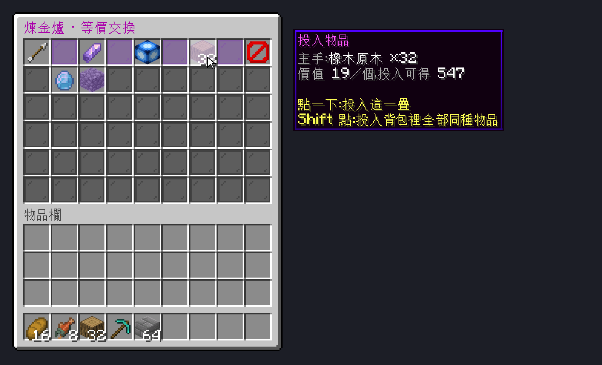
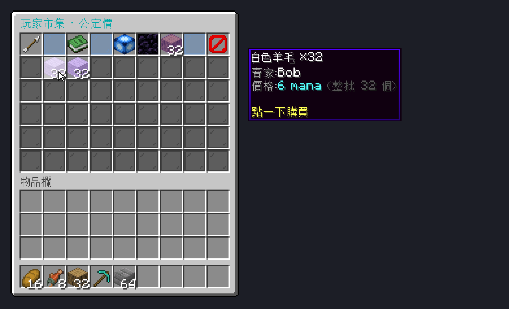
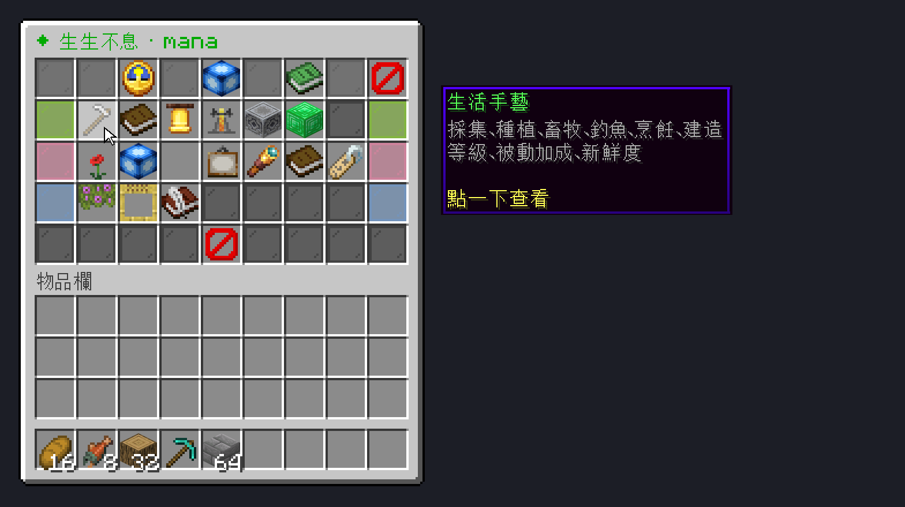
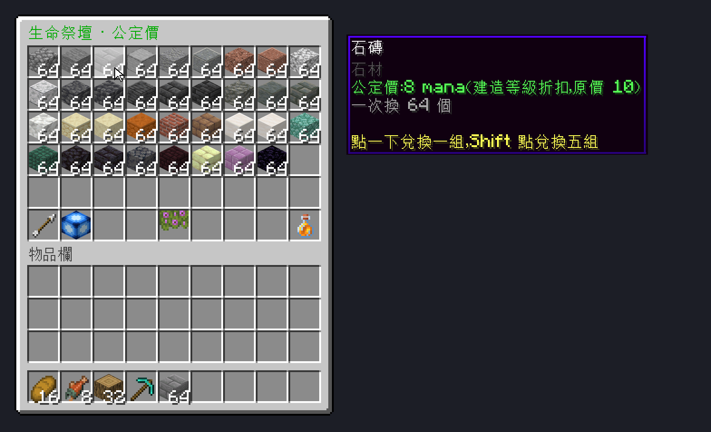

# ManaCore 1.5.0 —「生生不息」mana 核心插件

> 1.3.0 新增經濟系統（生活手藝、圖鑑、城鎮訂單、委託板、合作挑戰、社區工程），設計說明見 [ECONOMY.md](ECONOMY.md)。

伺服器核心：DivineMC 26.3（Paper 分支）　Java 25　建置：`mvn package`（JDK 25 + Maven），輸出 `target/ManaCore-1.5.0.jar`（會先跑單元測試）
依賴：paper-api 26.3.build.231-stable（provided）、sqlite-jdbc 3.54.1.0（plugin.yml `libraries:` 執行時自動下載）

## 選單長什麼樣

`docs/gui/` 有每個選單的重繪圖（用官方客戶端材質照遊戲畫法畫的，不是遊戲截圖；產生方式見 `模擬工具/gui_render/`）：

| | | |
| --- | --- | --- |
|  |  |  |
|  |  |  |

## 原始碼結構（io.github.jun32036.manacore）

| 檔案 | 職責 |
| --- | --- |
| `ManaCorePlugin` | 進入點：載入設定、資料庫、各服務、指令、排程 |
| `Database` | SQLite，單一背景執行緒依序執行；餘額一律以差額寫入 |
| `ManaService` | 在線玩家快取、`earn`（每日上限＋AFK）、`spend`、`adjust`、`earnAnywhere`（離線也可）、歸土、跨日 |
| `Actions` | 指令與 GUI 共用的動作：感謝、贈與、捐獻、登記作品、留言、查詢留言/紀錄 |
| `LifeTree` | 生命之樹累積與階段祝福（執行設定中的主控台指令） |
| `Places` | 作品、地標、祭壇方塊位置（記憶體快取） |
| `MentorService` | 導師制度 |
| `AltarMenu` | 生命祭壇兌換介面（公定價、季節祭品） |
| `gui/Menu`、`gui/ManaMenu` | `/mana` 箱子選單框架與所有選單頁 |
| `listener/ChatListener` | 聊天接話 mana（1.2.0 重寫，見下） |
| `listener/ExploreTask` | 探索：生態域、結構、地標 |
| `listener/PlayerListener` | 進出、AFK、祭壇右鍵、Shift+F 開選單、成就 mana |
| `listener/LifeListener` | 1.3.0：生活手藝與圖鑑的事件（種植、採集、畜牧、釣魚、烹飪、建造）、防「放了再拆」、村民交易開關 |
| `economy/EconMath` | 1.3.0：新鮮度、多樣性、等級、訂單抽選、手續費等純計算（有單元測試） |
| `economy/CraftService` | 生活手藝：點數、每種手藝上限、經驗與等級 |
| `economy/DexService` | 圖鑑：一次性登錄與里程碑 |
| `economy/OrderService` | 城鎮訂單：每日抽選、交貨、全服進度、完成獎勵 |
| `economy/CommissionService` | 委託板：託管、交貨、確認、取消、逾期退回、助人 mana |
| `economy/CoopService` | 結伴偵測、合作挑戰（首領、突襲） |
| `economy/ProjectService` | 社區工程：捐物資、投入 mana、完工指令 |
| `gui/EconomyMenu` | 以上功能的選單頁 |
| `gui/Icons` | 1.4.0：代表 mana 的藍色寶石圖示（自訂材質頭顱） |
| `gui/Dialogs` | 1.5.0：對話框介面（主選單、分類頁、感謝／贈與／捐獻／服務委託表單、說明頁）；需要 1.21.6 以上客戶端 |
| `gui/Pager` | 1.5.0：翻頁清單；`Menu` 新增統一標題列、空格一律深色玻璃 |
| `gui/AlchemyMenu`、`gui/MarketMenu` | 1.5.0：煉金爐、玩家市集 |
| `economy/ValueTable` | 1.5.0：價值表（基礎值＋由配方推算，有單元測試） |
| `economy/AlchemyService` | 煉金爐：投入／換出、學會的物品、損耗 |
| `economy/MarketService` | 玩家市集：公定價上架、購買、退回 |
| `economy/Passives` | 手藝被動加成（多拿一份、雙胞胎、祭壇折扣） |
| `command/*` | `/mana`、`/thanks`、`/manaadmin` |

資料表：accounts、daily、ledger、discoveries、thanks_log、works、comments、mentors、landmarks、altars、kv；
1.3.0 新增 crafts、order_progress、order_contrib、commissions、project_state、project_needs、project_contrib；1.5.0 新增 alchemy、alchemy_known、market（mana.db，啟動時自動建立）。

## 指令

玩家：`/mana`（對話框主選單）、`/mana chest`（箱子版主選單）、`/mana status`、`/mana skills|dex|orders|board|projects|alchemy|market`、`/mana sell`（整疊上架）、`/mana request <數量> <酬謝>`、`/mana request service <酬謝> <說明>`、`/thanks [玩家] [原因]`（不加玩家開選單）、`/mana give|donate|tree|work set/list/remove|comment|comments|mentor|log`
管理員：`/manaadmin give|take|event|check|altar set/remove|landmark add/remove/list|tree [set]|decay|orders [reroll]|project list/reset|value [物品]|reload`、`/altar`

## 1.2.0 的反濫用規則（config 中有預設值，舊設定檔不必改）

- 聊天：一則回覆只算給一個人（提到名字者優先，否則最近一則有內容且未被回過的別人訊息）。
  `min-length-speaker: 3`（被接話的訊息需有 3 個有意義的字）、`min-length: 2`（回覆本身）、
  `max-per-pair-day: 5`（同一對玩家每日上限）、洗頻 `spam-burst: 6` / `spam-window-seconds: 30` / `spam-cooldown-seconds: 60`
- 感謝：`sources.thanks.max-per-pair-week: 3`（同一對 7 天內只有 3 天產生 mana）
- 留言：`sources.works.max-per-pair-week: 3`

## 版本紀錄

- 1.0.0：mana 來源、每日上限、歸土、生命之樹、祭壇、作品、導師、管理指令
- 1.1.0：`/mana` 圖形選單、預設留言、`Actions` 共用邏輯
- 1.2.0：修正聊天 mana 被洗頻與群聊灌水、同一對玩家的每日/每週上限
- 1.5.0：主選單與表單改為伺服器對話框（按鈕、滑桿、文字輸入，分層：主選單 → 分類 → 功能；`menu.dialogs` 可關閉，`/mana chest` 開箱子版）；箱子頁面統一版面（標題列、翻頁、可做的項目發光、空格深色玻璃）；煉金爐（等價交換）；玩家市集（公定價）；手藝被動加成；祭壇 Shift 一次買五組
- 1.4.0：Shift+F 開啟選單；mana 圖示改為藍色寶石（聊天前綴 ◆）；達成原版成就得到大量 mana；祭壇改為分類翻頁、128 種常用方塊一組一組換（`altar.shop`，舊的 `altar.items` 不再使用）
- 1.3.0：經濟系統。「生產收成」改為六種生活手藝（新鮮度、多樣性、結伴加成、等級）；新增圖鑑、城鎮訂單、委託板、合作挑戰、社區工程；祭壇新增特別物品；可選關閉村民交易

## 安裝與升級

1. `mvn package` 產生 `target/ManaCore-1.5.0.jar`。
2. 測試服沿用 update 資料夾的做法：把新 jar 改名成和 `plugins\` 裡現有檔案**完全相同的檔名**（目前是 `ManaCore-1.0.0.jar`），放進 `plugins\update\`，再重啟伺服器。
3. 舊的 `config.yml` 不必改，新功能用內建預設值運作。要調整再把新區塊複製過去（見 ECONOMY.md 第 7 節）。
4. 舊的「生產收成」點數不再累積；過去的紀錄仍會以「生產收成（舊版）」顯示。

## 1.3.0 實機驗證清單（尚未在伺服器上跑過）

- [ ] 啟動無錯誤，`mana.db` 出現 7 張新表
- [ ] 收成 4 種成熟作物：動作列出現「生活手藝・種植」，`/mana skills` 的多樣性上升；圖鑑登錄作物
- [ ] 自己放原木再打掉：沒有採集點數；野生原木有
- [ ] 放 20 個不同方塊：10 分鐘內沒有建造 mana，約 10～11 分鐘後一次入帳；放了馬上拆掉的不入帳
- [ ] 背包塞滿後 Shift 點合成結果：沒有烹飪點數
- [ ] 釣魚、繁殖、剪毛、從熔爐拿烤馬鈴薯、合成麵包：各自加點並登錄圖鑑
- [ ] `/mana orders`：顯示 6 張訂單；交貨扣物品、加 mana；交滿一張時全服公告並發完成獎勵；跨日（或 `/manaadmin orders reroll`）換新
- [ ] 委託板：A 發布物品委託（扣酬謝＋手續費，生命之樹增加）→ B 交貨 → A 收到物品、B 收到酬謝與助人 mana；A 離線時改為「我的委託」領取；服務委託的接下、確認、取消、放棄
- [ ] 社區工程：捐物資、投入 mana、完工指令執行
- [ ] 1.5.0 對話框：`/mana` 或蹲下按 F 開啟主選單，五個分類都能進出；感謝（文字輸入）、贈與（滑桿＋留言）、捐獻（滑桿）、發布服務委託（文字＋酬謝選項）、導師邀請與接受；箱子頁面按「返回」會回到對話框分類頁。**機器人無法開啟對話框，這部分只有編譯與伺服器端不報錯的驗證，請務必真人測。**
- [ ] 1.5.0：煉金爐投入／換出、市集上架／購買／收回、種植 Lv 高時多拿一份、建造 Lv 高時祭壇折扣（機器人已驗證，請用真人再走一次介面）
- [ ] 1.4.0：蹲下按 F 開啟選單；達成成就（例如 `/advancement grant 玩家 only minecraft:story/mine_diamond`）得到 mana；`/altar` 顯示分類、可翻頁購買；mana 圖示顯示為藍色寶石
- [ ] 兩人一起種田：結伴加成生效（主選單頭像顯示「身邊有 1 位夥伴」）
- [ ] 合作挑戰（需真人，ClaudeBot 的攻擊不會傳到伺服器）：兩人打遠古守衛或突襲勝利
